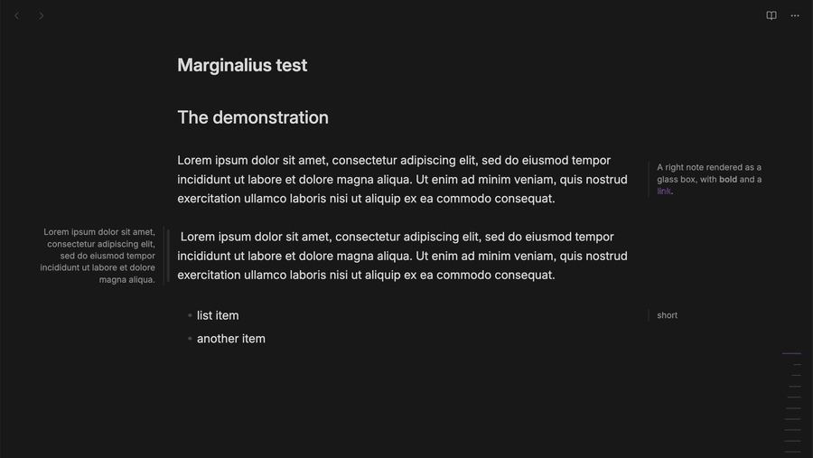
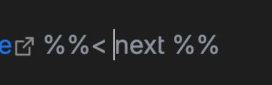

# Marginalius



Marginalius is an Obsidian plugin for Tufte/Cornell-style side notes. On a wide screen the notes sit in the page margins. When space is tight, they turn into small boxes embedded in the text.

You write a note once with an inline marker, and the plugin picks the layout from the width of the editor pane.

## Features

- One syntax gives two layouts. When there is room, the note sits in the side gutter beside the text column, borderless and in muted text, like a printed margin note. When there isn't, it becomes a small rounded box floated into the text, styled as liquid glass: an even translucent tint with blur, a bright rim fading from the upper-left and a lifted shadow. With **Reduce transparency** or **Increase contrast** turned on in your system settings, the box is solid instead.
- `%%> text %%` goes to the left margin and `%%< text %%` to the right.
- Markers can go anywhere in a paragraph. In the margin view the note sits at the middle of its paragraph's height, so a note on a one-line block such as a list item stays on that line. Two notes on the same side of one paragraph overlap.
- The syntax reuses Obsidian's comment delimiters (`%% … %%`), so if Marginalius is disabled, Obsidian treats the notes as ordinary comments and leaves no broken markup.
- Each note decides for itself. It stays in the margin while it fits there, and turns into a box only when its outer edge would come closer to the edge of the pane (for example a sidebar) than the **Pane edge gap** setting. The box appears where the margin note was, keeping that gap to the pane edge, with its top at the top of the paragraph, and slides further into the text as the pane narrows (for example when you widen a sidebar). Widening the pane moves it back out the same way.
- Words don't split across lines in a narrow margin. Non-breaking spaces in your notes (often typed with `Option+Space` on macOS, or pasted from rich text) are replaced at render time, so phrases wrap at real word boundaries. Your note is never changed.
- Selecting a rendered note in the editor puts the cursor at the start of its text, so you can type right away.
- A settings tab controls the widths and spacing.
- Text colors, borders and the readable line width come from your theme, in both Reading view and Live Preview.

## Usage

Put a marker inline in your text:

```markdown
%%> Result: only the mysql-backup pod can assume that role and write to S3;
other pods cannot. So yes: it's access control and least privilege. %%

Your main body text goes here. On a wide screen the note above is rendered
in the left margin next to this paragraph.

%%< This note is pulled into the right-hand margin instead. %%
```

| Marker | Side |
| --- | --- |
| `%%> text %%` | Left margin |
| `%%< text %%` | Right margin |

- The character right after the opening `%%` (`>` or `<`) sets the side.
- Everything between the markers is rendered as Markdown, so bold, italic and links work.
- Markers inside inline code or fenced code blocks are ignored, so you can write about the syntax without triggering it.
- To insert a marker, run **Insert left marginalia** or **Insert right marginalia** from the command palette. Selected text becomes the note, and with several selections each one becomes its own note. With nothing selected, you get an empty note with the cursor inside. A selection that already contains a note is left alone.

### Edit a note

Select a rendered note in the editor (Live Preview or Source mode) to edit it. It switches back to its source, and the cursor lands at the start of the text, right after the `%%>` or `%%<` marker. Links inside a note still open normally, and right-clicking a note leaves the cursor where it was.



Move the cursor out of the note and it renders again.

## Settings

**Settings → Community plugins → Marginalius**

| Setting | Description | Default |
| --- | --- | --- |
| **Margin note width** | Maximum width of a note in the margin. A short note takes less. | `200px` |
| **Gap to text** | Gap between a margin note and the text. | `20px` |
| **Pane edge gap** | Space kept between a note and the edge of the pane, such as a sidebar, on both sides. A note that would come closer becomes a box in the text. | `30px` |
| **Box width** | Maximum width of a note shown as a box in the text. A short note gets a box that fits its text. | `200px` |

Each value is a CSS length, such as `200px` or `12em`. A number without a unit (`200`) isn't valid CSS: the field shows an error and the value isn't saved. An empty field means the default. The settings use Obsidian's declarative settings, so they also show up in the settings search.

The values go into the CSS custom properties `--marginalius-width`, `--marginalius-margin`, `--marginalius-pane-gap` and `--marginalius-intrusive-width`, on the main window and on any popout windows.

## How it works

The code is split into small modules under `src/`:

- `main.ts`: the plugin lifecycle. It loads settings, sets the CSS variables, and registers everything else.
- `settings.ts`: the settings interface, defaults and settings tab. The tab declares its fields with `getSettingDefinitions()` and saves through the plugin, so the CSS variables and note placement update as you type. Invalid values saved by an older version are reset to the default on load.
- `parser.ts`: a regex parser with no Obsidian dependencies. It finds every `%%> … %%` and `%%< … %%` in a string, skipping inline code and fenced code blocks, and returns each match with its document offsets, side and normalized content. Normalizing replaces non-breaking characters (`U+00A0`, `U+202F`, `U+2007`, the word joiner/ZWNBSP, and the non-breaking hyphen) with ordinary ones so narrow notes wrap. Your note is never changed.
- `note.ts`: builds the note element and renders its Markdown with Obsidian's `MarkdownRenderer`. Both views use it.
- `placement.ts`: decides for each note whether it fits in the margin. A `ResizeObserver` measures each note in the margin layout (how far its outer edge reaches from the column), again whenever a setting changes, and watches the pane. When the free space beside the column gets smaller than that, the note gets the `marginalia-intrudes` class and becomes a box. It also records the free space as `--marginalius-room-left` and `--marginalius-room-right`, and measures list indents so left notes line up with the column edge.
- `live-preview.ts`: a CodeMirror `StateField` that decorates the editor. It is a state field because notes can span several lines. Each marker is hidden where it is, and the note is drawn as a `MarginaliaWidget` at the start of the marker's line, so a box floats from the top of its paragraph rather than from wherever the marker sits. When the cursor or selection touches a marker, the raw source shows so you can edit it, and selecting a widget puts the cursor at the start of the note's text.
- `reading-view.ts`: a `MarkdownPostProcessor` for Reading view. Obsidian strips `%% … %%` comments before rendering, so the processor gets the raw Markdown from `getSectionInfo()` and finds the notes with the shared parser. Each note goes into the list item it belongs to (Obsidian renders a whole list as one block), or else into its paragraph. If a full re-render passes no source text, the processor reads the file instead. Obsidian only hides a comment inside one paragraph, so a note that crosses a blank line would show as plain text; the processor renders those blocks again without the note.
- `commands.ts`: the **Insert left marginalia** and **Insert right marginalia** commands.
- `styles.css`: all the presentation. The box in the text (floated, rounded, liquid glass) is the default. Its rim is a 1px gradient ring on `::before`, cut out with a mask. While a note fits in the margin, it is positioned absolutely beside the column and centered on its block: the editor line, list item or paragraph.

### How the box slides in

A box's outer margin is negative by the free space beside the column:

```text
margin-right = -(free space on the right)   /* left notes use margin-left */
```

The free space already leaves out the **Pane edge gap**, so a box that has just stopped fitting keeps its outer edge where the margin note's was, that gap away from the pane edge, and only its inner part reaches into the text. As the pane narrows, the free space shrinks and the box moves further in until it sits fully inside the column. Reading view adds a little extra separation in the margin (`--marginalius-edge`) because its text sits slightly closer to the gutter than the editor's.

> Note: The margin layout needs **Readable line length** turned on (the default), because that setting creates the side gutters. With it off, notes are boxes at any width.

## Development

Requirements: Node.js 18+ and npm.

```bash
# install dependencies
npm install

# development build with watch
npm run dev

# production build (type-check + bundle)
npm run build

# tests (parser, Live Preview decorations, Reading view placement, insert command, margin/box placement)
npm test

# lint with Obsidian's plugin rules (eslint-plugin-obsidianmd)
npm run lint
```

`npm run build` type-checks with `tsc` and bundles `src/main.ts` into `main.js` with esbuild (see `esbuild.config.mjs`). Tests use Node's built-in test runner with a small stub of the `obsidian` API (`test/obsidian-stub.ts`), because the real API only exists inside the app.

### Install manually

Copy the release files into your vault's plugin folder, reload Obsidian, and enable the plugin in **Settings → Community plugins**:

```bash
cp main.js manifest.json styles.css "<Vault>/.obsidian/plugins/marginalius/"
```

A release needs `main.js`, `manifest.json` and `styles.css`. Marginalius needs Obsidian 1.13 or later.

## Privacy

Marginalius runs locally. It makes no network requests, collects no telemetry, and never changes your notes on disk. The non-breaking-space replacement only affects what is rendered on screen.

## Acknowledgments

- [obsidian-sidenote-auto-adjust-module](https://github.com/crnkv/obsidian-sidenote-auto-adjust-module) by crnkv was the initial inspiration for Marginalius.
- [cornell-marginalia](https://github.com/latazadehomero/cornell-marginalia) by latazadehomero inspired the Cornell-style margin notes.

## License

GPL-3.0, see [LICENSE](LICENSE).
